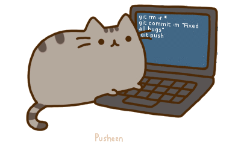

<table width="100%">
  <tr>
    <td width="300" align="center" valign="middle">
      
    </td>
    <td width="1000" align="center" valign="middle">
      <h1><b>Dang Ngoc Huy</b></h1>
      <h3><b>Software Engineer &middot; Data Engineer</b></h3>
    </td>
  </tr>
</table>

---

  <h3> 💻 Languages and Tools </h3>
  

   
  

 

---

<h3 align="center">📬 Contact</h3>

---

<h3 align="center">⚔️ Code &amp; Soulslikes</h3>

<table align="center">
  <tr>
    <td align="center" valign="middle">
      
    </td>
    <td width="2" style="border-left: 2px solid #8b949e;"></td>
    <td align="center" valign="middle">
      
    </td>
  </tr>
</table>

---

<h3 align="center">Contribution Activity</h3>

  <picture>
    <source
      media="(prefers-color-scheme: dark)"
      srcset="https://raw.githubusercontent.com/NgcHuyzz/NgcHuyzz/pacman-output/pacman-contribution-graph-dark.svg"
    />
    <source
      media="(prefers-color-scheme: light)"
      srcset="https://raw.githubusercontent.com/NgcHuyzz/NgcHuyzz/pacman-output/pacman-contribution-graph.svg"
    />
    
  </picture>

